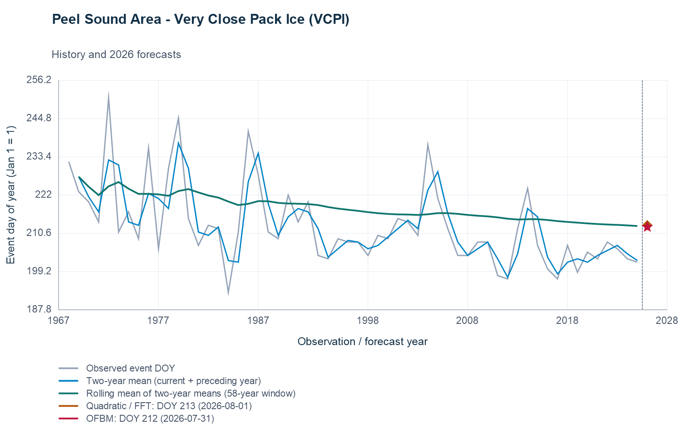

# SEF - Statistical Events Forecasting Model

[Project website](https://karagang.github.io/SEF-Statistical-Events-Forecasting-Model/) · [Ready-to-run downloads](https://github.com/karagang/SEF-Statistical-Events-Forecasting-Model/releases/tag/v1.0.0) · [Annual how-to](docs/guide.html) · [Model paper](docs/downloads/April-2017-Arctic-Ice-Event-Forecasting.pdf)

Arctic ice-event forecasting from historical annual event dates, with independent Python and C# implementations and 55 regional datasets. The repository contains the code, data, documentation and a responsive GitHub Pages site with actual output images and an interactive archived-results explorer.



## Choose an implementation

| Version | Start here | Runtime |
| --- | --- | --- |
| **C#** | [CSharp/README.md](CSharp/README.md), or download the Windows release and run `SEFM.exe` | Windows x64; .NET runtime included in the downloadable app |
| **Python** | [Python/README.md](Python/README.md) | Python 3.12 recommended; install `requirements.txt` |

Each version has its own copy of each region's `input/observations.csv`, metadata and historical smoothing snapshot. The C# application also includes immutable numerical test fixtures. The compiled C# executable is provided as a **release asset**, rather than a tracked Git file. Virtual environments and build caches are excluded.

## Forecast 2027

Append each region's actual 2026 observation to the CSV in the version you use. For example, `2026,204.0` is an observation row, not a forecast-year setting. Use the real regional DOY, keep all earlier observations, and update all selected regions consistently.

From the extracted CSharp folder:

```powershell
.\SEFM.exe all
```

From the Python folder, after creating its virtual environment:

```powershell
.\.venv\Scripts\python.exe run_forecasts.py
.\.venv\Scripts\python.exe build_reports.py --year 2027 --pdf-only
```

The forecast year is the last observed year plus one. Confirm `55/55 regions completed`, review the warnings and plots, then open each region's `output-2027` and the combined `reports/output-2027` directory. The supplied input snapshots end in 2025 and the archived example run forecasts 2026. No fictional 2026 observation has been added to the inputs.

For editable PowerPoint reports from Python results, the standalone C# report writer can read the saved Python outputs. With the two folders side by side, run from their parent:

```powershell
.\CSharp\SEFM.exe reports --root .\Python --year 2027 --destination .\Python\reports
```

See the [complete website guide](https://karagang.github.io/SEF-Statistical-Events-Forecasting-Model/guide.html).

## Repository map

* `Python/`: shared runner, calculation module, report helpers, input data and tests.
* `CSharp/`: native C# source, build script, input data, fixtures and runtime notices.
* `data/observations.csv`: all 2,741 input observations in one table with Region, Year and DOY.
* `docs/`: the static website, selected actual output images, annual guide, method notes and model paper.

Complete software packages and archived C#-generated reports are in the [v1.0.0 release](https://github.com/karagang/SEF-Statistical-Events-Forecasting-Model/releases/tag/v1.0.0).

## Method and verification

The defaults use an FFT-selected rolling window with expanding early averages, two-year pre-averaging from the workbooks, and next-year forecast indexing. The historical FFT forecast label is a quadratic fit after smoothing; OFBM retains the translated legacy coefficient updates. See [methodology and limitations](https://karagang.github.io/SEF-Statistical-Events-Forecasting-Model/methodology.html).

The C# implementation passed 274 Python comparison cases across all 55 regions, plus the original legacy prediction vectors and boundary tests. Reproducibility is not a claim of predictive accuracy. These are statistical guidance and archived examples, not a current operational ice forecast or an official agency service.

## Research paper and attribution

André April (2017), *Statistical Forecast Model for Ice-Related Events in the Arctic*. American Meteorological Society. [DOI: 10.1175/WAF-D-16-0139.1](https://doi.org/10.1175/WAF-D-16-0139.1).

The paper retains its original copyright and reuse terms. No new blanket license is applied to the paper or data by this repository. Microsoft runtime license and third-party notices accompany the C# distribution. The original user notes are retained as historical reference; use the current how-to guide for the updated workflow.

## Website maintenance

GitHub Pages publishes the `docs/` folder from `main`. Edit its buildless HTML, CSS, JavaScript and assets, then commit. See [WEBSITE.md](WEBSITE.md) for the content-refresh procedure.
